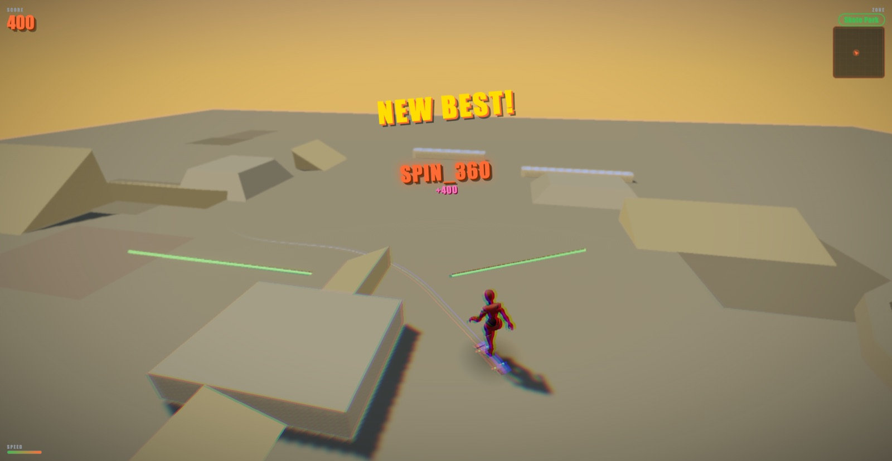

# Amman Skateboard Legend

A 3D skateboarding game set in Amman, playable in the browser.

**[Play it](https://anank-sudo.github.io/amman-skateboard-legend/)** on a desktop with a keyboard.



## What it does

- Three zones to skate: a skate park, a street spot with stair sets and handrails, and Old Amman, rebuilt from a reference photo of the 7 Hills skate park.
- Physics-driven riding: ollies, kickflips, heelflips, tre flips, grinds, manuals, grabs and spins, chained into combos with a multiplier.
- Toon shading under an Amman sky dome, with bloom, depth of field and warm golden fog.
- Scoring, challenges, unlocks and personal bests, saved in the browser.

## Controls

WASD move, Space ollie, J kickflip, K heelflip, J+K tre flip, F grind, Shift manual, L grab, Tab switch zones, Esc pause.

## How I built it

I wrote the specs and directed AI coding agents (Claude Code) that wrote the code, then played every change to check it. The hardest part was the physics. The skater kept flying off terrain and fighting double gravity until the body became kinematic and ground contact moved to raycasts. Walls got their own horizontal raycast, so the skater slides along them instead of being stopped by the base of a ramp.

## Run it locally

```sh
npm install
npm run dev
npm run test:run
```

## Status

Paused hobby project. Last gameplay change 2026-06-19; playable end to end. Every push to `main` deploys to GitHub Pages.

## Credits

Built with Three.js, cannon-es, pmndrs/postprocessing, Vite and Vitest. Character: X Bot from Adobe Mixamo, used under Mixamo's terms.

## License

All rights reserved. The code is public to read, not licensed for reuse.
